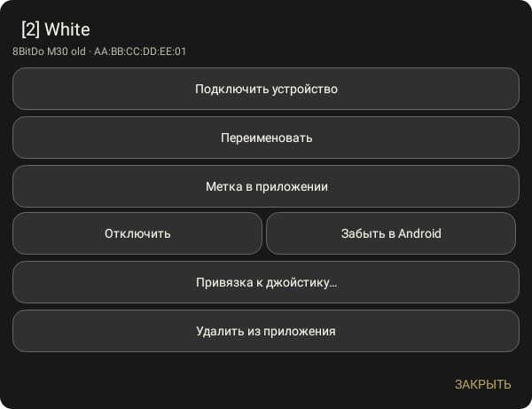

# M30 Companion · 8BitDo M30 Bluetooth

[<kbd>🇷🇺 Русский</kbd>](#русский) &nbsp; [<kbd>🇬🇧 English</kbd>](#english)

## Русский

Помощник для подключения и проверки геймпадов 8BitDo M30 на Android и Android TV.

**[Скачать APK 1.60](https://github.com/GokSssss/8BitDo-M30-Bluetooth/releases/download/v1.60/1.60-M30-Companion.apk)**

### Что умеет

- **Подключение:** поиск M30 и выбор сохранённой пары. Панель Bluetooth открывается рядом со схемой; закрытие возвращает к прежнему месту.
- **Проверка кнопок:** подсветка на схеме, направления крестовины, коды нажатий и значения осей.
- **Два джойстика:** отдельные профили и подписи; на широком экране обе схемы видны рядом.
- **Схема и подписи:** собственные имена устройств и соответствие нажатий кнопкам на схеме.
- **Управление устройствами:** очистка метки, номера и привязки в приложении. После удаления пары в Android список обновляется; найденный заново M30 можно снова сопрячь. Отключение внутри приложения доступно на поддерживаемых версиях Android; удаление системной пары выполняется в настройках.
- **Справка:** режимы включения M30, сопряжение и переключение крестовины.
- **Информация:** версия приложения, прошивка и заряд при наличии данных.

### Интерфейс

Снимки из тестовой среды Android.

Приложение помогает проверить и подписать кнопки на схеме. Режим геймпада переключается на самом M30.

Проверочный выпуск. Для Obtainium включите **Предварительные выпуски**.

[Помощь](docs/USAGE.md#русский) · [История версий](CHANGELOG.md#русский) · [Файлы выпуска](https://github.com/GokSssss/8BitDo-M30-Bluetooth/releases/tag/v1.60)

[↑ Русский / English](#m30-companion--8bitdo-m30-bluetooth)

---

## English

A companion app for connecting and testing 8BitDo M30 controllers on Android and Android TV.

**[Download APK 1.60](https://github.com/GokSssss/8BitDo-M30-Bluetooth/releases/download/v1.60/1.60-M30-Companion.apk)**

### Features

- **Connection:** find an M30 and select a saved pair. Bluetooth opens beside the controller diagram; closing it restores the previous position.
- **Button testing:** highlights on the controller diagram, D-pad directions, button codes and axis values.
- **Two controllers:** separate profiles and labels; wide screens show both diagrams side by side.
- **Diagram and labels:** name devices and match their input to buttons on the diagram.
- **Device management:** clear an app label, number and slot link. Removing a pair in Android refreshes the list; a rediscovered M30 can be paired again. In-app disconnection is available on supported Android versions; removing the system pair uses Android settings.
- **Help:** M30 startup modes, pairing and D-pad switching.
- **Information:** app version, firmware and battery when available.

### Interface

Screenshots from an Android test environment.

The app helps you test and label buttons on its diagram. Switch the controller's mode on the M30 itself.

Preview release. Enable **Pre-releases** in Obtainium.

[Help](docs/USAGE.md#english) · [Version history](CHANGELOG.md#english) · [Release files](https://github.com/GokSssss/8BitDo-M30-Bluetooth/releases/tag/v1.60)

[↑ Русский / English](#m30-companion--8bitdo-m30-bluetooth)

---

[Документация для разработчика / Developer documentation](docs/DEVELOPMENT.md) · [Источники и лицензии / Sources and licenses](THIRD-PARTY-NOTICES.txt) · [Проект на Диске / Project on Drive](https://drive.google.com/drive/folders/1xpfasnpQiuKJIOZR_sKqb0012qggvoiY)
